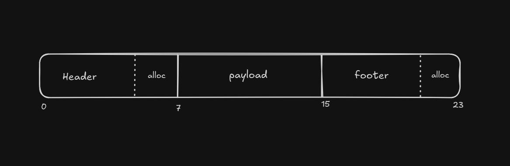
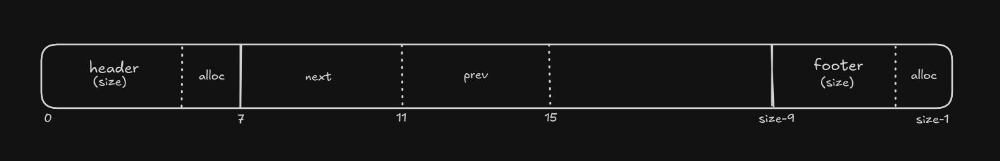
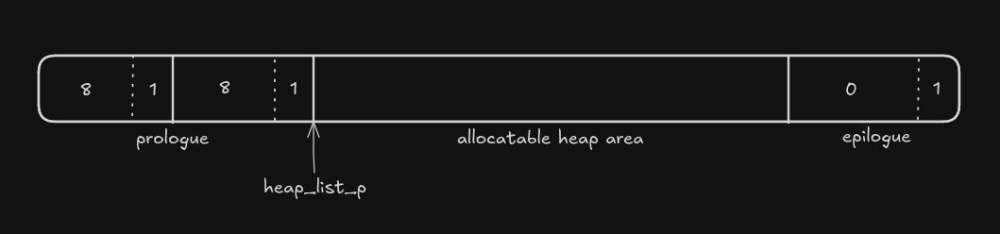
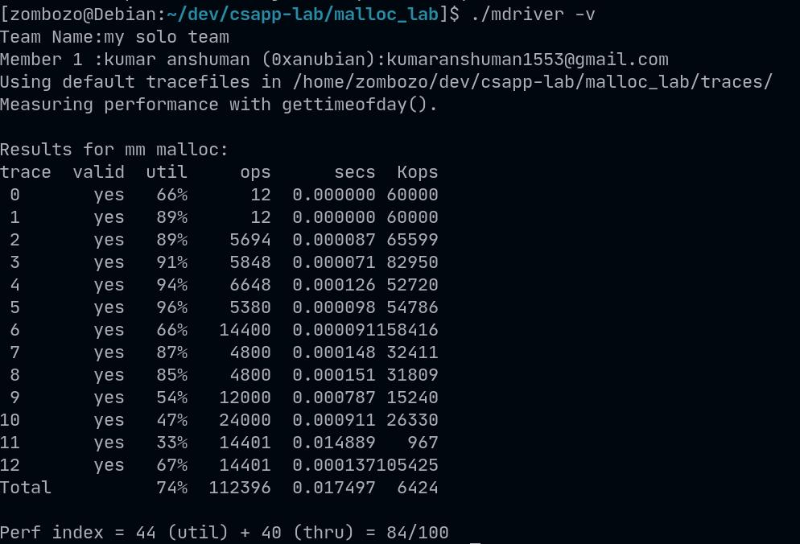

## Introduction

I've been reading the [CSAPP](https://csapp.cs.cmu.edu/) book and recently I finished its malloc lab where I implemented my own dynamic allocator package in which I implemented `malloc()`, `free()` and `realloc()` functions for a 32-bit architecture. The lab was really interesting and challenging so i decided to write this blog/writeup for it to share my approach to this lab.
You can download the lab from [here](https://csapp.cs.cmu.edu/3e/labs.html).

I have written this writeup in an easy to understand way however if you want to really understand it you should know how dynamic allocation works so either read the Chapter 9 of the CSAPP book or you may read this online series about [memory allocation strategies](https://www.gingerbill.org/series/memory-allocation-strategies/) by [@TheGingerBill](https://twitter.com/TheGingerBill).

Let's dive into it.

## Design of my memory allocator

In my allocator implementation an allocated chunk will have a 8 bytes long header field and a 8 bytes long footer field. The memory addresses of the payload(address that will be returned to the user after a call to `malloc()`) will always be `8-bytes` alligned as it is in the `glibc malloc package`. As everything is `8-bytes` alligned, the *3 low order bits* of the size field will always be `0` so we can put some other information at those bits without messing with the size of our chunk.

My implementation is going to use an explicit doubly linked list for freed chunks which will follow LIFO. So that searching for a freed chunk will of `O(n)` in number of free blocks. So a freed chunk will too have a header and footer field but it will also have `prev` and `next` fields that will point to the previous and next freed chunk in the free list.

### allocated chunk



- As you can see at the start of an allocated chunk there is a header field that contains the size of the chunk and the `alloc bit`, which will be 0 or 1 if its freed or allocated respectively.
- The size of header and footer fields is 8 bytes each and since my implementation is `8-bytes` alligned so the minimum size of payload fiend is also 8.
- Thus the minimum size of my allocated chunk is 24 bytes.
- But since the implementation is for 32-bit architecture, the size in the header and footer is only 4 bytes long, wasting 4 bytes at both header and footer, thus having an internal fragmentation of 8 bytes per chunk.

### Freed chunk



- The header and footer field is same as of an allocated chunk but a freed chunk will have `next` and `prev` pointer field that will point to the next and previous freed chunk in the explicit free list.
- Since a pointer in 32-bit architecture is only 4 bytes long so our `next` and `prev` fields can perfectly fit in the minimum payload size.
- Thus minimum size of a freed chunk is also 24 bytes.

### allocatable heap area



- The heap will have a prologue at the start and an epilogue at the end that will always be allocated.
- They will act as boundaries so that my coallescing logic doesn't mess with anything outside the heap while searching for a previous or next adjacent freed chunk.
- There is a pointer `heap_list_p` that will always be pointing to the start of my allocatable heal area or arena.
- The space between the prologue and epilogue is our arena where my allocated and freed chunks will be.
- I can grow the heap by calling `extend_heap()` if needed. 

## Implementation

Before anything I made some definitions to help me manage raw bytes as I didn't use any `struct` or other complex data structure.

Most of these definitions are self explanatory and have comments to explain their purpose so I will not explain them again.

```c
/* single word (4) or double word (8) alignment */
#define ALIGNMENT 8

/* rounds up to the nearest multiple of ALIGNMENT */
#define ALIGN(size) (((size) + (ALIGNMENT-1)) & ~0x7)


#define SIZE_T_SIZE (ALIGN(sizeof(size_t)))

/* definitions by me */

/* word size */
#define WSIZE 4
#define DSIZE 8

/* size of chunk to grow the heap i.e. 4096 or 4KB */
#define CHUNKSIZE (1 << 12)

/* Minimum chunk size in this implementation */
#define MIN_CHUNK_SIZE 24

/* find max between two numbers */
#define MAX(x, y) ((x) > (y)? (x) : (y))  

/* pack size and alloc bit */
#define PACK(size, alloc)  ((size) | (alloc))

/* get and put the value stored at a chunk pointer */
#define GET(p)       (*(unsigned int *)(p))
#define PUT(p, val)  (*(unsigned int *)(p) = (val))

/* retrive size and allocation bit from a chunk pointer */
#define GET_SIZE(p)  (GET(p) & ~0x7)
#define GET_ALLOC(p) (GET(p) & 0x1)

/* retrieve header and footer address from a block pointer */
#define HDRP(bp)       ((char *)(bp) - DSIZE)
#define FTRP(bp)       ((char *)(bp) + GET_SIZE(HDRP(bp)) - (2 * DSIZE))
#define PREV_FTRP(bp)  ((char *)(bp) - (2 * DSIZE))

/* retrieve address of next and previous block pointer from current block pointer */
#define NEXT_BLKP(bp)  ((char *)(bp) + GET_SIZE(((char *)(bp) - DSIZE)))
#define PREV_BLKP(bp)  ((char *)(bp) - GET_SIZE(((char *)(bp) - (2 * DSIZE))))

/* retrive the next_freed_pointer from a freed block pointer */
#define NEXT_FREEDP(bp)     GET(bp)

/* retrive the prev_freed_pointer from a freed block pointer */
#define PREV_FREEDP(bp)     GET((char *)bp+WSIZE)

/* put the next_freed_pointer to a freed block pointer */
#define PUT_NEXT(bp, val)    PUT(bp, val)

/*put the prev_freed_pointer to a freed block pointer */
#define PUT_PREV(bp, val)    PUT((char *)bp+WSIZE, val)

/* a pointer to the start of heap */
static void *heap_listp;

/* a pointer to the explicit free list */
void *free_listp = 0;
```

### mm_init()

This function initialises the heap using `mem_sbrk()` which is pre-implemented lab version of the `sbrk()` linux syscall. It increases the heap size and returns the address of start of newly created heap.

```c
int mm_init(void)
{
    /* reset the free_listp address */
    free_listp = NULL;
    /* call mem_sbrk to setup an empty free list */
    if ((long)(heap_listp = mem_sbrk(3 * DSIZE)) == -1)
        return -1;
    
    /* puts padding, prologue and epilogue into the empty free list */
    PUT((char *)(heap_listp), PACK(8, 1));
    PUT(((char *)heap_listp + DSIZE), PACK(8, 1));
    heap_listp = (char*)heap_listp + (2 * DSIZE);
    PUT(heap_listp, PACK(0, 1));

    if (extend_heap(CHUNKSIZE/DSIZE) == NULL)
        return -1;

    return 0;
}
```

- It first resets the free list pointer as the driver program that verifies this implementation calls `mm_init()` everytime and storing the previous free list can cause a crash.
- It then calls `mem_sbrk(3 * DSIZE)` to allocate a basic heap arena that only has prologue and epilogue in it.
- It then puts prologue and epilogue and sets `heap_listp` to its position and calls `extend_heap()` to extend the heap for our allocatable heap area or arena.

### extend_heap

```c
/*
 * extends the heap by the given word count and returns the payload addr of 
 * chunk
 */
static void *extend_heap(size_t words)
{
    void *bp;
    size_t size;

    /* adjust no of words to form allignement and then initialize size */
    size = (words % 2) ? (words + 1) * DSIZE : words * DSIZE;

    /* calls mem_sbrk to extend the heap */
    if ((long)(bp = mem_sbrk(size)) == -1)
        return NULL;

    /* puts the header and pooter into the new free chunk and puts the new epilogue */
    PUT(HDRP(bp), PACK((size), 0));
    PUT(FTRP(bp), PACK((size), 0));
    PUT(HDRP(NEXT_BLKP(bp)), PACK(0, 1));

    /* insert the newly created free chunk in the free list */
    insert_at_head(bp);

    /* calls coalesce to coalesce any contigous free chunk */
    return coalesce(bp);
}
```

- It first calculates the size of memory to extend the heap with that is valid with my allignment policy.
- It then extends the heap with `mem_sbrk` and puts the `size` and `alloc` bit in the header and footer of the newly extended region.
- It creates a new epilogue and inserts the new free block at the head of my explicit free list.
- It then calls `coalesce()` to coalesce any adjacent free chunk to the `bp` and returns its return value.

### coalesce

```c
/* coalesce any contigous freed chunks */
static void *coalesce(void *bp)
{
    int prev_chunk_allocated = GET_ALLOC(PREV_FTRP(bp));
    int next_chunk_allocated = GET_ALLOC(HDRP(NEXT_BLKP(bp)));
    size_t size = GET_SIZE(HDRP(bp));

    /* if both adjacent chunks are allocated then return bp */
    if (prev_chunk_allocated && next_chunk_allocated)
        return bp;

    /*
     * if prev adjacent chunk is allocated but next is freed then increase the 
     * size of current chunk with of next chunk then unlink both chunks from
     * the free list and insert the new coalesced chunk at the head of free list
     */
    else if (prev_chunk_allocated && !next_chunk_allocated) {
        unlink_chunk(bp);
        unlink_chunk(NEXT_BLKP(bp));

        size += GET_SIZE(HDRP(NEXT_BLKP(bp)));
        PUT(HDRP(bp), PACK(size, 0));
        PUT(FTRP(bp), PACK(size, 0));
        
        insert_at_head(bp);
    }
    
    /*
     * if prev adjacent chunk is freed but next is not then increase the size
     * of prev chunk with of the current chunk then unlink both chunks from the
     * free list and insert the new coalesced chunk at the head of free list 
     */
    else if (!prev_chunk_allocated && next_chunk_allocated) {
        unlink_chunk(bp);
        unlink_chunk(PREV_BLKP(bp));

        size += GET_SIZE(HDRP(PREV_BLKP(bp)));
        PUT(FTRP(bp), PACK(size, 0));
        PUT(HDRP(PREV_BLKP(bp)), PACK(size, 0));

        insert_at_head(PREV_BLKP(bp));
        bp = PREV_BLKP(bp);
    }

    /*
     * if both adcanet chunks are freed then increment size with the size of 
     * but adjacent chunks then unlink all 3 chunks and insert the coalesced 
     * one at the head of free list
     */
    else if (!prev_chunk_allocated && !next_chunk_allocated) {
        unlink_chunk(bp);
        unlink_chunk(PREV_BLKP(bp));
        unlink_chunk(NEXT_BLKP(bp));

        size += GET_SIZE(bp-DSIZE-DSIZE);
        size += GET_SIZE(FTRP(bp)+DSIZE);
        PUT(HDRP(PREV_BLKP(bp)), PACK(size, 0));
        PUT(FTRP(NEXT_BLKP(bp)), PACK(size, 0));

        insert_at_head(PREV_BLKP(bp));
        bp = PREV_BLKP(bp);
    }
    return bp;
}
```

- If first gets the `alloc bit` of the adjacent chunks of `bp`.
- If the both adjacent chunks are allocated it returns `bp`
- before coalescing it unlinks all the operable chunks from the free list.
- If only next chunk is freed then it adds the size of next chunk in the size of current chunk and puts the new `size` and `alloc bit` in the new coalesced chunk.
- If only previous chunk is freed then it adds the size of current chunk to the size of previous chunk and puts the new `size` and `alloc bit` in the new coalesced chunk.
- If both adjacent chunk is freed then it adds the size of current and next chunk to the size of previous chunk and puts the new `size` and `alloc bit` in the new coalesced chunk.
- In all the 4 cases it insert the new coalesced chunk at the head of my explicit free list.
- It returns the start of the memory address of payload block of the coalesced chunk **which is the memory address of payload block of previous chunk in case 3 and 4 and of next chunk in case 2**

### unlink_chunk and insert_at_head

```c
/* unlinks a free chunk from the linked list of freed chunks */
void unlink_chunk(void *bp)
{
    if (PREV_FREEDP(bp) != 0)
        PUT_NEXT(PREV_FREEDP(bp), NEXT_FREEDP(bp));
    else free_listp = (void *)NEXT_FREEDP(bp);
    
    if (NEXT_FREEDP(bp) != 0)
        PUT_PREV(NEXT_FREEDP(bp), PREV_FREEDP(bp));
}

/* insert a free chunk at the head of free list */
void insert_at_head(void *bp) 
{
    PUT_PREV(bp, 0);
    PUT_NEXT(bp, (long)free_listp);
    if(free_listp != 0)
        PUT_PREV(free_listp, (long)bp);
    free_listp = bp;
}
```

These two are self explanatory, they unlinks and links a chunk in the doubly linked free list

### mm_malloc

```c
/* 
 * mm_malloc - allocate a new chunk by first searching the free list. If no
 * freed block satisfies the size then extend the heap and cut extra size in 
 * bothe condition by calling place(). returns the payload address of new chunk
 * allocated
 */
void *mm_malloc(size_t size)
{
    if (size == 0)
        return NULL;

    size_t asize = ALIGN(size);
    asize += 16;
    
    void *bp = find_free(asize);
    if (bp != NULL) {
        place(bp, asize);
        return bp;
    }

    size_t esize = MAX(asize, (CHUNKSIZE+16));
    bp = extend_heap(esize/DSIZE);
    if (bp == NULL)
        return NULL;

    unlink_chunk(bp);
    PUT(HDRP(bp), PACK(GET_SIZE(HDRP(bp)), 1));
    PUT(FTRP(bp), PACK(GET_SIZE(HDRP(bp)), 1));
  
    place(bp, asize);
    return bp;
}
```

- It first aligns the size to my `8 bytes` alignment policy and adds `16` to it for the header and footer field for the allocated chunk.
- It searches for a free chunk that satisfies the requested size and if it finds one then it places it and return its payload address
- If a free chunk is not found then it extends the heap using `extend_heap()` and then unlinks the the newly created free chunk and mark it allocated. It then places it and return its payload address.

### place

```c
/*
 * if the residual size is greater or equal to the size of minimum chunk size 
 * then cut that extra size chunk and mark it free and insert it to the explicit
 * free list
 */
void place(void *bp, size_t size)
{
    if (GET_SIZE(HDRP(bp)) >= (size + (3 * DSIZE))) {
        size_t default_size = GET_SIZE(HDRP(bp));
        size_t curr_size = size;
        size_t next_size = default_size - size;

        // put size and alloc bit of the allocated current block
        PUT(HDRP(bp), PACK(curr_size, 1));
        PUT(FTRP(bp), PACK(curr_size, 1));

        // put size and unalloc bit of the new freed block
        void *nxt_bk = NEXT_BLKP(bp);
        PUT(HDRP(nxt_bk), PACK(next_size, 0));
        PUT(FTRP(nxt_bk), PACK(next_size, 0));
        insert_at_head(nxt_bk);
    }
}
```

- The job of `place()` is to cut off any extra space from the allocated chunk to minimise any internal fragmentation.
- It first checks if the size of the chunk is greater than the requested size by minimum chunk size (which is 24).
- if yes then it cuts the residual memory region and mark it free and insert it to the free list.
- It puts the new optimal size and `alloc bit` to the current allocated chunk.

### find_free

```c
/* 
 * traverses the explicit free list and if the size of a freed chunk is 
 * greater than or equal to the size requested then it sets the allocaated
 * of the chunk, unlinks it from the free list and return the block pointer
 * otherwise it returns NULL
 */
void *find_free(size_t size)
{
    void *bp = free_listp;

    while (bp != 0) {
        size_t chunk_size = GET_SIZE(HDRP(bp));
        if (chunk_size == 0)
            return NULL;

        if (chunk_size >= size) {
            unlink_chunk(bp);
            PUT(HDRP(bp), PACK(chunk_size, 1));
            PUT(FTRP(bp), PACK(chunk_size, 1));
            return bp;
        }
        bp = (void *)NEXT_FREEDP(bp);
    }
    return NULL;
}
```

It traverses the the free list and if the size of a freed chunk is greater than or equal to the requested size then it unlinks that chunk, mark it free and returns its payload address.

### mm_free

```c
/*
 * mm_free - sets the allocated bit of the chunk to 0 and adds the chunk to 
 * free list and then calls coalesce().
 */
void mm_free(void *ptr)
{
    if (ptr == NULL)
        return;
    size_t size = GET_SIZE(HDRP(ptr));
    PUT(HDRP(ptr), PACK(size, 0));
    PUT(FTRP(ptr), PACK(size, 0));
    insert_at_head(ptr);
    coalesce(ptr);
}
```

This is a very simple function
- It first checks if the chunk to free is not a null pointer, if yes it returns.
- It then marks that chunk freed and insert it to the explicit free list.
- It calls `coalesce()` on the freed chunk to merge any adjacent freed chunk to it.

### mm_realloc

```c
void *mm_realloc(void *ptr, size_t size)
{
    if (ptr == NULL)
        return mm_malloc(size);

    if (size == 0) {
        mm_free(ptr);
        return NULL;
    }

    size_t asize = ALIGN(size);
    asize += 16;
    size_t initial_chunk_size = GET_SIZE(HDRP(ptr));

    /* 
     * if asize is less than or equal to the size of chunk pointed to by ptr 
     * then shrink the chunk and free the residual chunk if size of residual
     * chunk is greater or equal to minimum chunk size. no need to copy any 
     * payload contents 
     */
    if (asize <= initial_chunk_size) {
        size_t residual_size = initial_chunk_size - asize;
        if (residual_size >= MIN_CHUNK_SIZE) {
            PUT(HDRP(ptr), PACK(asize, 1));
            PUT(FTRP(ptr), PACK(asize, 1));
            
            PUT(HDRP(NEXT_BLKP(ptr)), PACK(residual_size, 0));
            PUT(FTRP(NEXT_BLKP(ptr)), PACK(residual_size, 0));
            insert_at_head(NEXT_BLKP(ptr));
            coalesce(NEXT_BLKP(ptr));
            return ptr;
        }
        return ptr;
    }

    /* 
     * If next chunk after current chunk is free and it will satisfy the chunk
     * size requirement then absorb the next chunk and see if the residual size
     * is greater or equal to MIN_CHUNK_SIZE, if yes then mark it free and add
     * it to the free list
     */
    int is_next_chunk_freed = !(GET_ALLOC(HDRP(NEXT_BLKP(ptr))));
    size_t next_chunk_size = GET_SIZE(HDRP(NEXT_BLKP(ptr)));
    size_t new_chunk_size = initial_chunk_size + next_chunk_size;

    if (is_next_chunk_freed && (initial_chunk_size + next_chunk_size >= asize)) {
        unlink_chunk(NEXT_BLKP(ptr));
        PUT(HDRP(ptr), PACK(new_chunk_size, 1));
        PUT(FTRP(ptr), PACK(new_chunk_size, 1));

        size_t residual_size = GET_SIZE(HDRP(ptr)) - asize;
        if (residual_size >= MIN_CHUNK_SIZE) {
            PUT(HDRP(ptr), PACK(asize, 1));
            PUT(FTRP(ptr), PACK(asize, 1));

            PUT(HDRP(NEXT_BLKP(ptr)), PACK(residual_size, 0));
            PUT(FTRP(NEXT_BLKP(ptr)), PACK(residual_size, 0));
            insert_at_head(NEXT_BLKP(ptr));
            coalesce(NEXT_BLKP(ptr));
        }
        return ptr;
    }

    /*
     * if next chunk is the epilogue then extend the heap and the absorb the 
     * newly created free block 
     */
    if (!is_next_chunk_freed && (next_chunk_size == 0)) {
        size_t deficit = asize - initial_chunk_size;
        //deficit = ALIGN(deficit) + 16;
        void *nbk = extend_heap(deficit/DSIZE);
        if (nbk == NULL)
            return NULL;

        unlink_chunk(nbk);
        size_t nsize = initial_chunk_size + GET_SIZE(HDRP(nbk));
        PUT(HDRP(ptr), PACK(nsize, 1));
        PUT(FTRP(ptr), PACK(nsize, 1));

        return ptr;
    }

    /*
     * last case if we can't find and absorb any next chunk then malloc a new
     * chunk and copy the contents there and free the old chunk 
     */
    void *oldptr = ptr;
    void *newptr;
    size_t copySize;
    
    newptr = mm_malloc(size);
    if (newptr == NULL)
      return NULL;

    copySize = GET_SIZE(HDRP(ptr));
    copySize = copySize - (2 * DSIZE);
    
    if (size < copySize)
      copySize = size;
    
    memcpy(newptr, oldptr, copySize);
    mm_free(oldptr);
    return newptr;
}
```

- It checks if the chunk to reallocate is a null pointer or the requested size is 0, if yes it acts as `mm_malloc(size)` and `mm_free(ptr)` respectively.
- It aligns the requested size to 8 byte alignment policy and adds the size of header and footer field to it.
- If the requested size is less than the size of chunk pointed to by `ptr`, it frees the residual chunk, insert it to the free list and coalesce to adjacent freed chunks.
- If next chunk after current chunk is free and it can satisfy the chunk size requirement then it absorbs the next chunk and if the residual size is greater than or equal to the `MIN_CHUNK_SIZE` then it marks it free and adds it to the free list.
- If the next chunk is the epilogue then it extends the heap and then absorbs the newly created free block 
- If it can't find and absorb the next chunk then it `mm_malloc` a new chunk of new size and copies the data at memory pointed to by `ptr` to there and then it `mm_free` the old chunk.

## Final thoughts



My implementation scored 84 out of 100 by the CMU's driver that came with the lab handout, which is a nice score. But there is place for optimisations. First thing that comes in my mind is that i barely use the footer field in my implementation so i can maybe remove it from my design that will increase mu utilisation score. Other is that in `mm_realloc` i can introduce a case of if the previous adjacent chunk is free and satisfies the size requirement.

Perhaps I can optimise it further later.

## original readme that came with the lab handout

```
#####################################################################
# CS:APP Malloc Lab
# Handout files for students
#
# Copyright (c) 2002, R. Bryant and D. O'Hallaron, All rights reserved.
# May not be used, modified, or copied without permission.
#
######################################################################

***********
Main Files:
***********

mm.{c,h}	
	Your solution malloc package. mm.c is the file that you
	will be handing in, and is the only file you should modify.

mdriver.c	
	The malloc driver that tests your mm.c file

short{1,2}-bal.rep
	Two tiny tracefiles to help you get started. 

Makefile	
	Builds the driver

**********************************
Other support files for the driver
**********************************

config.h	Configures the malloc lab driver
fsecs.{c,h}	Wrapper function for the different timer packages
clock.{c,h}	Routines for accessing the Pentium and Alpha cycle counters
fcyc.{c,h}	Timer functions based on cycle counters
ftimer.{c,h}	Timer functions based on interval timers and gettimeofday()
memlib.{c,h}	Models the heap and sbrk function

*******************************
Building and running the driver
*******************************
To build the driver, type "make" to the shell.

To run the driver on a tiny test trace:

	unix> mdriver -V -f short1-bal.rep

The -V option prints out helpful tracing and summary information.

To get a list of the driver flags:

	unix> mdriver -h
```
